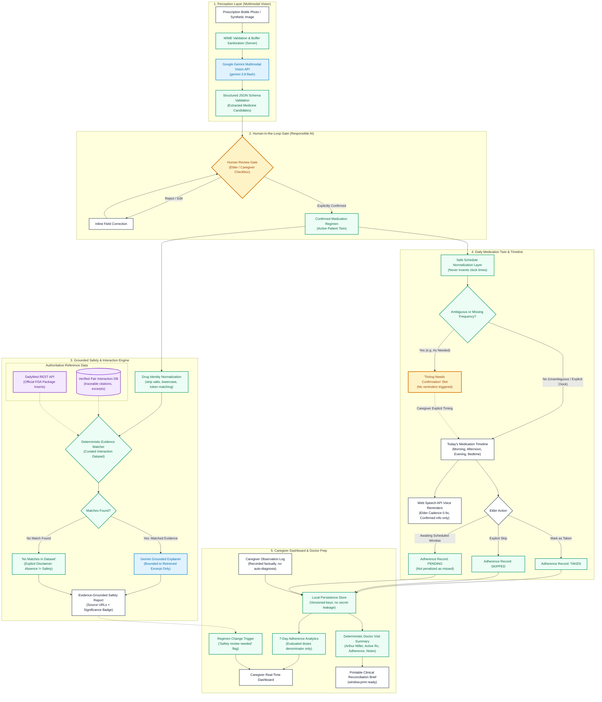
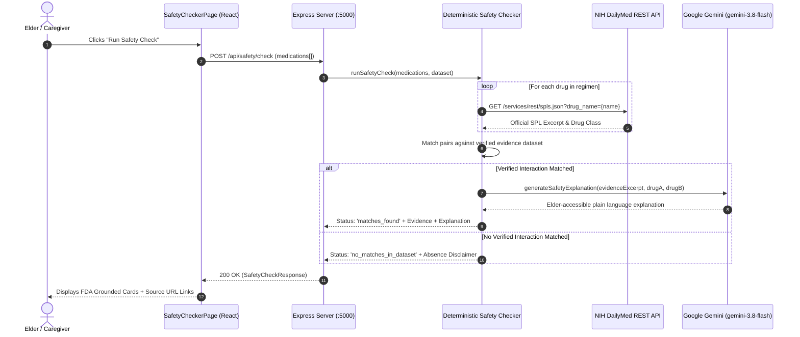
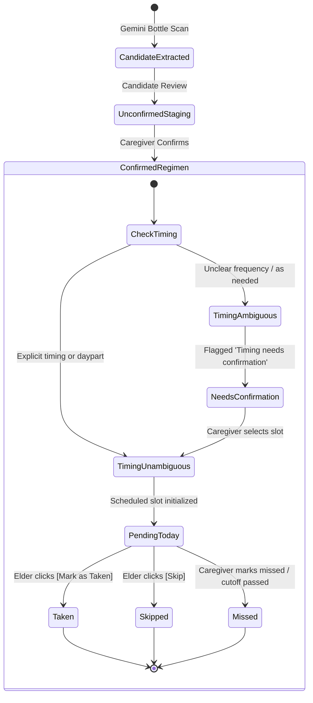

# MedSafe Twin — System Architecture & Workflow Pipeline

> **Academic Prototype Notice**: This document details the end-to-end system architecture for *MedSafe Twin — Polypharmacy Guardian for Elders*. The system demonstrates multimodal generative perception, grounded deterministic safety checking, human-in-the-loop verification gates, and Responsible AI design boundaries.

---

## 1. High-Level Architecture Flowchart

---

## 2. Layer-by-Layer Architectural Separation

The system maintains a strict **four-tier architectural taxonomy**:

| Tier | Component | Technological Role | Safety & Integrity Boundary |
| :--- | :--- | :--- | :--- |
| **Model-Generated Perception** | Gemini 3.8 Flash Vision (`server/src/services/geminiService.ts`) | Extracts label text, drug name, dosage, prescriber from bottle image. | Output is untrusted candidate data. Stored in staging only; **never** added directly to the active medical twin. |
| **Human-in-the-Loop Gate** | Review Table (`client/src/pages/PrescriptionScannerPage.tsx`) | Allows elder/caregiver to verify and adjust dosage, route, food rules. | Requires explicit checkbox confirmation before writing to regimen. |
| **Deterministic Engine** | Normalizer & Matcher (`server/src/services/safetyCheckerService.ts`, `server/src/utils/scheduleNormalizer.ts`) | Performs exact token matching against evidence; creates daily schedule slots without inventing hours. | **Zero hallucination risk**: 100% rule-based and traceable. Cannot invent drugs, doses, or interactions. |
| **Grounded LLM Explainer** | Gemini Explanation (`server/src/services/geminiService.ts`) | Translates retrieved excerpts into plain, calm 8th-grade reading level text. | Strict system prompt: **Forbidden** to declare interactions that are not present in the retrieved excerpt. |
| **External Evidence** | NIH DailyMed API & Curated Evidence | Provides official FDA package insert excerpts and peer-reviewed citations. | Ground truth reference source. If missing, the app explicitly states coverage is limited. |

---

## 3. DailyMed Integration Path

---

## 4. Medication Schedule & Adherence State Machine

---

## 5. Persistence & Secret Isolation Architecture

- **Browser Storage Isolation**:
  - Keys use versioned namespace: `medsafe_twin_v1_schedules`, `medsafe_twin_v1_adherence`, `medsafe_twin_v1_observations`, `medsafe_twin_v1_settings`, `medsafe_twin_v1_medications`.
  - **Zero Secret Exposure**: No API keys, credentials, or prescription raw images are stored in `localStorage`.
  - **Graceful Fallback**: Corrupted JSON entries are caught by `try/catch` and fall back to initial synthetic demo state without throwing.
- **Server Environment Protection**:
  - `GEMINI_API_KEY` is loaded strictly on the backend (`server/src/index.ts`) via `dotenv`.
  - All responses strip internal configuration details.
  - The client communicates only with `/api/` endpoints over HTTP/JSON.
